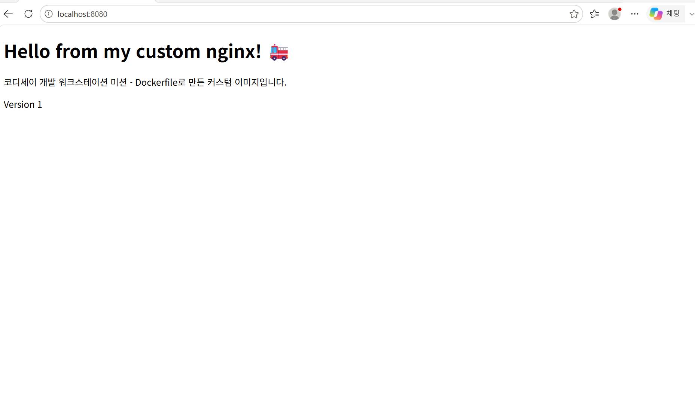
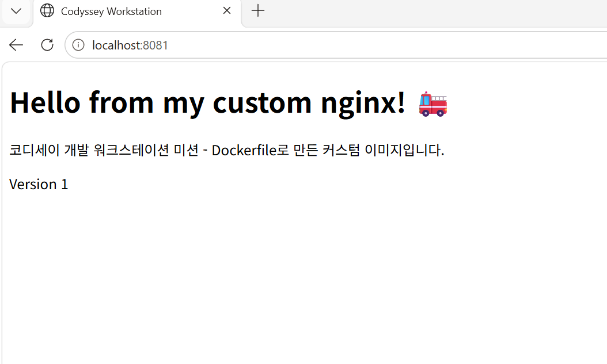

# 개발 워크스테이션 구축 미션 (Codyssey)

## 1. 프로젝트 개요

터미널, Docker, Git/GitHub로 **누가 실행해도 같은 결과가 나오는 개발 환경**을 직접 구성하고, 그 결과를 로그와 스크린샷으로 검증한 기록입니다.

- 터미널로 작업 디렉토리를 다루고 파일·디렉토리 권한을 바꿔 봄
- Docker 설치를 점검하고 컨테이너를 실행·관리함 (run / ps / logs / stats / stop / rm, attach와 exec 비교)
- `nginx:alpine`을 베이스로 **Dockerfile을 직접 작성**해 커스텀 웹서버 이미지를 만듦
- 포트 매핑(8080, 8081)으로 브라우저에서 접속을 확인함
- **바인드 마운트**로 호스트 파일 수정이 즉시 반영되는지, **Docker 볼륨**으로 컨테이너를 삭제해도 데이터가 남는지 검증함
- Git 사용자 설정, GitHub 저장소 생성, VSCode 연동을 완료함

## 2. 실행 환경

| 항목 | 값 |
|---|---|
| Host OS | Windows 11 (10.0.26300) |
| Linux 환경 | WSL2 + Ubuntu 26.04.1 LTS |
| Shell | GNU bash 5.3.9 |
| Terminal | VSCode 통합 터미널 (WSL: Ubuntu 원격 연결), Windows Terminal |
| Docker | Docker Desktop 4.99.0 / Docker Engine 29.9.3 (WSL integration: Ubuntu) |
| Git | 2.53.0 |
| Editor | Visual Studio Code + WSL 확장 |

📸 [Ubuntu / bash 버전 확인](docs/screenshots/07-1-env-version.png)

> ⚠️ **재현 시 주의 (Windows 환경)**
> - 모든 작업은 **WSL Ubuntu의 리눅스 홈(`~`) 아래**에서 합니다. `/mnt/c/...`(윈도우 드라이브)에서는 `chmod`가 제대로 적용되지 않습니다.
> - Docker Desktop을 먼저 설치했다면 WSL 기본 배포판이 `docker-desktop`으로 잡혀 있을 수 있습니다. `wsl --set-default Ubuntu`로 바꿔야 합니다. ([트러블슈팅 2](#트러블슈팅-2-vscode가-ubuntu가-아닌-docker-desktop-배포판에-연결됨))
> - Docker Desktop → Settings → Resources → **WSL integration**에서 Ubuntu를 켜야 Ubuntu 터미널에서 `docker` 명령을 쓸 수 있습니다.

## 3. 프로젝트 구조

```
codyssey-workstation/
├── README.md              # 기술 문서 (이 파일)
├── Dockerfile             # 커스텀 nginx 이미지 설계도
├── app/
│   └── index.html         # 웹서버가 보여줄 정적 페이지
└── docs/
    └── screenshots/       # 검증 스크린샷
```

## 4. 수행 체크리스트

- [x] 터미널 기본 조작 (위치 확인, 숨김 파일 포함 목록, 이동, 생성, 복사, 이동/이름변경, 삭제, 내용 확인, 빈 파일 생성)
- [x] 권한 변경 실습 (파일 1개 644→755, 디렉토리 1개 755→700, 변경 전/후 비교)
- [x] Docker 설치 및 점검 (`docker --version`, `docker info`)
- [x] Docker 기본 운영 (pull, images, run, ps, ps -a, logs, stats, stop, rm)
- [x] hello-world 실행
- [x] ubuntu 컨테이너 진입 후 명령 실행, attach와 exec 차이 관찰
- [x] Dockerfile로 커스텀 이미지 빌드 및 실행 (`nginx:alpine` 기반)
- [x] 포트 매핑 접속 (8080, 8081 두 번, 브라우저와 curl)
- [x] 바인드 마운트 반영 (호스트 수정 전/후 비교)
- [x] Docker 볼륨 영속성 (컨테이너 삭제 전/후 비교)
- [x] Git 설정 (`user.name`, `user.email`, `init.defaultBranch`)
- [x] GitHub 저장소 생성, clone, VSCode 연동 및 push

## 5. 검증 방법 요약

| 검증 항목 | 사용한 명령 | 확인한 결과 | 증거 |
|---|---|---|---|
| 터미널 조작 | `pwd`, `ls -la`, `mkdir`, `cp`, `mv`, `rm`, `cat`, `touch` | 파일 생성·복사·이동·삭제가 목록에 반영됨 | [6-1](#6-1-터미널-기본-조작) |
| 권한 | `ls -l`, `ls -ld`, `chmod` | 644→755, 755→700, `chmod 000` 시 Permission denied | [6-2](#6-2-권한-실습) |
| Docker 점검 | `docker --version`, `docker info` | Client와 Server가 모두 응답함 (데몬 동작) | [6-3](#6-3-docker-설치-및-점검) |
| 컨테이너 운영 | `run`, `ps -a`, `logs`, `stats`, `stop`, `rm` | 상태 변화(Up → Exited → 삭제) 확인 | [6-4](#6-4-docker-기본-운영-및-컨테이너-실습) |
| 커스텀 이미지 | `docker build`, `docker inspect`, `printenv` | 빌드 성공, LABEL·ENV 적용, `(healthy)` | [6-5](#6-5-dockerfile-기반-커스텀-이미지) |
| 포트 매핑 | `docker run -p`, `curl`, 브라우저 | 8080·8081 모두 내 페이지 응답 | [6-6](#6-6-포트-매핑-접속) |
| 바인드 마운트 | `docker run -v $(pwd)/app:...`, `sed`, `curl` | 8082는 즉시 Version 2, 8080은 Version 1 유지 | [6-7](#6-7-바인드-마운트-반영) |
| 볼륨 영속성 | `docker volume create`, `docker rm -f`, `cat` | 컨테이너 삭제 후에도 데이터 유지, 볼륨이 없으면 사라짐 | [6-8](#6-8-docker-볼륨-영속성) |
| Git/GitHub | `git config --list`, `git clone`, `git remote -v` | 설정 완료, 원격 저장소 연결, VSCode에서 push | [6-9](#6-9-git-설정-및-github-연동) |

---

## 6. 수행 로그

### 6-1. 터미널 기본 조작

실습 폴더는 제출 저장소 바깥(`~/codyssey/practice`)에 만들었습니다.

```bash
$ cd ~
$ pwd
/home/jung78o97809
$ mkdir -p ~/codyssey/practice
$ cd ~/codyssey/practice              # 절대 경로로 이동
$ pwd
/home/jung78o97809/codyssey/practice
$ ls -la
total 8
drwxr-xr-x 2 jung78o97809 jung78o97809 4096 Nov 21 11:37 .
drwxr-xr-x 3 jung78o97809 jung78o97809 4096 Nov 21 11:37 ..

$ touch empty.txt                     # 빈 파일 생성
$ echo "hello codyssey" > note.txt
$ cat note.txt                        # 파일 내용 확인
hello codyssey
$ cat empty.txt                       # 빈 파일이라 출력 없음

$ mkdir backup
$ cp note.txt backup/                 # 복사
$ mv note.txt memo.txt                # 이름 변경
$ mv memo.txt backup/                 # 이동
$ ls -la backup
-rw-r--r-- 1 jung78o97809 jung78o97809   15 Nov 21 11:39 memo.txt
-rw-r--r-- 1 jung78o97809 jung78o97809   15 Nov 21 11:40 note.txt
$ rm backup/note.txt                  # 삭제
$ ls -la backup
-rw-r--r-- 1 jung78o97809 jung78o97809   15 Nov 21 11:39 memo.txt

$ cd ..                               # 상대 경로: 한 단계 위로
$ pwd
/home/jung78o97809/codyssey
$ cd practice                         # 상대 경로로 다시 진입
$ pwd
/home/jung78o97809/codyssey/practice
```

📸 [기본 조작 1](docs/screenshots/01-1-terminal-basic-a.png) · [기본 조작 2](docs/screenshots/01-2-terminal-basic-b.png)

**절대 경로와 상대 경로**
- **절대 경로**는 루트(`/`)부터 시작하는 전체 주소입니다. `cd ~/codyssey/practice`(= `/home/jung78o97809/codyssey/practice`)는 현재 위치와 상관없이 항상 같은 곳으로 갑니다.
- **상대 경로**는 현재 위치를 기준으로 한 주소입니다. `codyssey` 폴더 안에서 `cd practice`는 성공하지만, 다른 위치에서 실행하면 실패합니다. `..`은 한 단계 위, `.`은 현재 폴더를 뜻합니다.

### 6-2. 권한 실습

```bash
$ touch perm-file.txt
$ mkdir perm-dir

# 변경 전
$ ls -l perm-file.txt
-rw-r--r-- 1 jung78o97809 jung78o97809 0 Nov 21 11:48 perm-file.txt
$ ls -ld perm-dir
drwxr-xr-x 2 jung78o97809 jung78o97809 4096 Nov 21 11:48 perm-dir

# 권한 변경
$ chmod 755 perm-file.txt
$ chmod 700 perm-dir

# 변경 후
$ ls -l perm-file.txt
-rwxr-xr-x 1 jung78o97809 jung78o97809 0 Nov 21 11:48 perm-file.txt
$ ls -ld perm-dir
drwx------ 2 jung78o97809 jung78o97809 4096 Nov 21 11:48 perm-dir

# 추가 실험: 권한을 모두 없애면 소유자도 읽을 수 없음
$ chmod 000 perm-file.txt
$ cat perm-file.txt
cat: perm-file.txt: Permission denied
$ chmod 644 perm-file.txt
$ ls -l perm-file.txt
-rw-r--r-- 1 jung78o97809 jung78o97809 0 Nov 21 11:48 perm-file.txt
```

📸 [권한 변경 전/후](docs/screenshots/01-3-permission.png)

| 대상 | 변경 전 | 변경 후 |
|---|---|---|
| `perm-file.txt` (파일) | `-rw-r--r--` (644) | `-rwxr-xr-x` (755) |
| `perm-dir` (디렉토리) | `drwxr-xr-x` (755) | `drwx------` (700) |

**권한 표기 해석 규칙**
- `rwx`는 읽기(r) / 쓰기(w) / 실행(x)입니다. 디렉토리에서 x는 "그 안으로 들어갈 수 있음"을 뜻합니다.
- 세 묶음은 순서대로 **소유자(owner) / 그룹(group) / 기타(others)**입니다.
- 숫자 표기는 각 묶음에서 **r=4, w=2, x=1을 더한 값**입니다.
  - `755` = `rwx`(7) `r-x`(5) `r-x`(5): 소유자만 수정할 수 있고 모두가 읽고 실행할 수 있음. 실행 파일과 디렉토리에 주로 사용
  - `644` = `rw-`(6) `r--`(4) `r--`(4): 소유자만 수정할 수 있고 모두가 읽을 수 있음. 일반 파일에 주로 사용
  - `700` = 소유자만 모든 권한, 나머지는 접근 불가

### 6-3. Docker 설치 및 점검

```bash
$ docker --version
Docker version 29.9.3, build 5457199

$ docker info
Client:
 Version:    29.9.3
 Context:    default
 ...
Server:
 Containers: 0
  Running: 0
  Paused: 0
  Stopped: 0
 Images: 0
 Server Version: 29.9.3
 Storage Driver: overlay2
 ...
```

`Client`와 `Server`가 모두 출력되므로 Docker 데몬이 정상 동작 중입니다.

📸 [WSL integration 설정](docs/screenshots/02-1-docker-wsl-integration.png) · [docker --version / info (Client)](docs/screenshots/02-2-docker-version-info-a.png) · [docker info (Server)](docs/screenshots/02-3-docker-info-b.png)

### 6-4. Docker 기본 운영 및 컨테이너 실습

**hello-world 실행, 이미지 다운로드와 목록 확인**
```bash
$ docker run hello-world
Unable to find image 'hello-world:latest' locally
latest: Pulling from library/hello-world
...
Hello from Docker!
This message shows that your installation appears to be working correctly.
...

$ docker pull ubuntu
$ docker pull nginx:alpine
$ docker images
IMAGE                ID             DISK USAGE   CONTENT SIZE
hello-world:latest   e2ac70e7319a   10.1kB       0B
nginx:alpine         62d1c420c34a   63MB         0B
ubuntu:latest        a8acf325a119   102MB        0B

$ docker ps
CONTAINER ID   IMAGE   COMMAND   CREATED   STATUS   PORTS   NAMES
$ docker ps -a
CONTAINER ID   IMAGE         COMMAND    CREATED              STATUS                      PORTS   NAMES
c8afae12ece4   hello-world   "/hello"   About a minute ago   Exited (0) About a minute ago       sharp_bassi
```

📸 [hello-world](docs/screenshots/02-4-hello-world.png) · [pull / images / ps](docs/screenshots/02-5-pull-images-ps.png)

**ubuntu 컨테이너 진입 후 명령 실행**
```bash
$ docker run -it --name my-ubuntu ubuntu bash
root@2bf4d7f3420e:/# ls
bin  boot  dev  etc  home  lib  lib64  media  mnt  opt  proc  root  run  sbin  srv  sys  tmp  usr  var
root@2bf4d7f3420e:/# echo "hello from container"
hello from container
root@2bf4d7f3420e:/# cat /etc/os-release
PRETTY_NAME="Ubuntu 26.04.1 LTS"
...
root@2bf4d7f3420e:/# exit

$ docker ps -a
CONTAINER ID   IMAGE    COMMAND   CREATED          STATUS                     NAMES
2bf4d7f3420e   ubuntu   "bash"    44 seconds ago   Exited (0) 9 seconds ago   my-ubuntu
```

**attach와 exec 비교**
```bash
$ docker run -dit --name ubuntu-bg ubuntu bash
$ docker ps
f88c01d409e0   ubuntu   "bash"   7 seconds ago   Up 6 seconds   ubuntu-bg

# exec: 새 bash를 추가로 실행해서 진입
$ docker exec -it ubuntu-bg bash
root@f88c01d409e0:/# echo "exec test"
exec test
root@f88c01d409e0:/# exit
$ docker ps
f88c01d409e0   ubuntu   "bash"   42 seconds ago   Up 41 seconds   ubuntu-bg     # 계속 실행 중

# attach: 메인 프로세스(bash)에 직접 연결
$ docker attach ubuntu-bg
root@f88c01d409e0:/# exit
$ docker ps
CONTAINER ID   IMAGE   COMMAND   CREATED   STATUS   PORTS   NAMES              # 사라짐
$ docker ps -a
f88c01d409e0   ubuntu   "bash"   About a minute ago   Exited (0) 10 seconds ago   ubuntu-bg
```

📸 [ubuntu 컨테이너 진입](docs/screenshots/02-6-ubuntu-container.png) · [exec와 attach 비교](docs/screenshots/02-7-exec-vs-attach.png)

**관찰 정리**
- `docker run -it ... bash`로 들어간 뒤 `exit`하면 메인 프로세스(bash)가 끝나서 **컨테이너도 종료**됩니다.
- **exec**는 실행 중인 컨테이너에 **새 프로세스를 추가**로 실행합니다. 나와도 컨테이너는 **계속 실행(Up)**됩니다.
- **attach**는 컨테이너의 **메인 프로세스(PID 1)에 직접 연결**합니다. 거기서 `exit`하면 **컨테이너가 종료(Exited)**됩니다.
- 따라서 운영 중인 컨테이너를 점검할 때는 컨테이너를 끄지 않는 **exec**가 안전합니다.
- 컨테이너 안의 OS는 Ubuntu 26.04로, 호스트(WSL) 버전과 별개입니다. **격리된 실행 환경**이라는 것을 확인했습니다.

**로그, 리소스 확인, 중지, 삭제**
```bash
$ docker run -d --name web-test nginx:alpine
$ docker ps
180db6631a68   nginx:alpine   "/docker-entrypoint.…"   9 seconds ago   Up 9 seconds   80/tcp   web-test

$ docker logs web-test
/docker-entrypoint.sh: Configuration complete; ready for start up
2026/11/21 03:06:44 [notice] 1#1: nginx/1.31.9
2026/11/21 03:06:44 [notice] 1#1: start worker processes
...

$ docker stats --no-stream
CONTAINER ID   NAME       CPU %   MEM USAGE / LIMIT    MEM %   NET I/O          BLOCK I/O        PIDS
180db6631a68   web-test   0.00%   21.93MiB / 23.47GiB  0.09%   1.17kB / 126B    10.6MB / 12.3kB  25

$ docker stop web-test
$ docker ps -a
180db6631a68   nginx:alpine   ...   Exited (0) 9 seconds ago   web-test

$ docker rm web-test sharp_bassi
$ docker rm my-ubuntu ubuntu-bg
$ docker ps -a
CONTAINER ID   IMAGE   COMMAND   CREATED   STATUS   PORTS   NAMES
```

📸 [docker logs](docs/screenshots/02-8-docker-logs.png) · [stats / stop / rm](docs/screenshots/02-9-stats-stop-rm.png)

### 6-5. Dockerfile 기반 커스텀 이미지

**선택한 방식:** (A) 웹서버 베이스 이미지 활용. 공식 **`nginx:alpine`** 이미지에 정적 콘텐츠와 설정을 추가했습니다.

```dockerfile
# 1) 기존 베이스 이미지: 공식 nginx 경량(alpine) 버전
FROM nginx:alpine

# 2) 이미지 정보(메타데이터) 기록
LABEL org.opencontainers.image.title="codyssey-web" \
      org.opencontainers.image.authors="DoSquatBro"

# 3) 환경변수: 실행 환경 구분용
ENV APP_ENV=dev

# 4) 기본 페이지를 내 웹페이지로 교체
COPY app/ /usr/share/nginx/html/

# 5) 이 컨테이너가 80번 포트를 사용한다고 문서화
EXPOSE 80

# 6) 헬스체크: 30초마다 웹서버가 응답하는지 스스로 점검
HEALTHCHECK --interval=30s --timeout=3s \
  CMD wget -qO- http://127.0.0.1/ || exit 1
```

**커스텀 포인트와 목적**

| 커스텀 포인트 | 목적 |
|---|---|
| `FROM nginx:alpine` | 검증된 공식 웹서버를 가벼운(63MB) 버전으로 사용 |
| `LABEL` | 이미지 이름과 제작자를 기록해 관리·추적하기 쉽게 함 |
| `ENV APP_ENV=dev` | 실행 환경(개발/운영)을 컨테이너 안에서 구분 |
| `COPY app/` | nginx 기본 페이지를 내 정적 페이지로 교체 |
| `EXPOSE 80` | 컨테이너가 사용하는 포트를 문서화 |
| `HEALTHCHECK` | 웹서버가 실제로 응답하는지 Docker가 주기적으로 점검 |

**빌드와 실행 검증**
```bash
$ docker build -t codyssey-web:1.0 .
[+] Building 0.4s (7/7) FINISHED
 => [1/2] FROM docker.io/library/nginx:alpine
 => [2/2] COPY app/ /usr/share/nginx/html/
 => => naming to docker.io/library/codyssey-web:1.0

$ docker images
IMAGE                ID             DISK USAGE
codyssey-web:1.0     4b702767acaa   63MB
...

$ docker run -d --name web-check codyssey-web:1.0

$ docker exec web-check wget -q -O - http://127.0.0.1/
<!DOCTYPE html>
...
  <h1>Hello from my custom nginx! 🚒</h1>
...

$ docker exec web-check printenv APP_ENV
dev

$ docker inspect --format '{{json .Config.Labels}}' web-check
{..."org.opencontainers.image.authors":"DoSquatBro","org.opencontainers.image.title":"codyssey-web"}

$ docker ps
440f3a10cee0   codyssey-web:1.0   "/docker-entrypoint.…"   2 minutes ago   Up 2 minutes (healthy)   80/tcp   web-check
```

📸 [Dockerfile](docs/screenshots/03-1-dockerfile-vscode.png) · [build / images](docs/screenshots/03-2-build-images.png) · [ENV / LABEL](docs/screenshots/03-3-env-label-wget-error.png) · [HTML 응답](docs/screenshots/03-4-wget-html.png) · [healthy](docs/screenshots/03-5-healthy.png)

### 6-6. 포트 매핑 접속

```bash
$ docker run -d -p 8080:80 --name web-8080 codyssey-web:1.0
$ docker run -d -p 8081:80 --name web-8081 codyssey-web:1.0
$ docker ps
CONTAINER ID   IMAGE              STATUS                    PORTS                                     NAMES
152859606c43   codyssey-web:1.0   Up 4 seconds (health: starting)   0.0.0.0:8081->80/tcp, [::]:8081->80/tcp   web-8081
6eaff2ea7a98   codyssey-web:1.0   Up 55 seconds (healthy)   0.0.0.0:8080->80/tcp, [::]:8080->80/tcp   web-8080

$ curl http://localhost:8080
...<h1>Hello from my custom nginx! 🚒</h1>...<p>Version 1</p>...
$ curl http://localhost:8081
...<h1>Hello from my custom nginx! 🚒</h1>...<p>Version 1</p>...
```

| `localhost:8080` | `localhost:8081` |
|---|---|
|  |  |

📸 [run / ps / curl](docs/screenshots/04-1-port-run-ps-curl.png)

**포트 매핑이 필요한 이유:** 컨테이너는 격리된 네트워크 공간에서 실행됩니다. 그래서 컨테이너 안에서 80번 포트를 열어도(`80/tcp`) 바깥에서는 접근할 수 없습니다. `-p <호스트포트>:<컨테이너포트>`로 호스트의 포트를 컨테이너 포트에 연결해야 브라우저에서 접속할 수 있습니다. 같은 이미지라도 호스트 포트를 다르게 주면(8080, 8081) 여러 컨테이너를 동시에 띄울 수 있습니다.

### 6-7. 바인드 마운트 반영

비교를 위해 이미지에 COPY된 페이지를 보여주는 `web-8080`은 그대로 두고, `app/` 폴더를 바인드 마운트한 `web-bind`(8082)를 추가로 실행했습니다.

```bash
$ docker run -d -p 8082:80 --name web-bind \
  -v $(pwd)/app:/usr/share/nginx/html \
  codyssey-web:1.0

# 변경 전
$ grep Version app/index.html
  <p>Version 1</p>
$ curl -s http://localhost:8082 | grep Version
  <p>Version 1</p>
$ curl -s http://localhost:8080 | grep Version
  <p>Version 1</p>

# 호스트에서 파일 수정 (재빌드·재시작 없음)
$ sed -i 's/Version 1/Version 2 - bind mount 반영!/' app/index.html
$ grep Version app/index.html
  <p>Version 2 - bind mount 반영!</p>

# 변경 후
$ curl -s http://localhost:8082 | grep Version     # 바인드 마운트: 즉시 반영
  <p>Version 2 - bind mount 반영!</p>
$ curl -s http://localhost:8080 | grep Version     # 이미지 복사본: 그대로
  <p>Version 1</p>
```

📸 [바인드 마운트 실행](docs/screenshots/05-1-bind-mount-run.png) · [변경 전/후 비교](docs/screenshots/05-2-bind-mount-compare.png) · [브라우저 8082 변경 후](docs/screenshots/05-3-browser-8082-after.png)

> 변경 전 상태는 위 `curl` 결과(`Version 1`)로 확인했습니다.

**정리:** `COPY`는 빌드 시점의 **복사본**을 이미지에 넣기 때문에 원본을 고쳐도 반영되지 않습니다. 바인드 마운트는 **호스트 폴더 자체**를 연결하기 때문에 수정이 즉시 반영됩니다. 개발할 때는 바인드 마운트가 편리하고, 배포할 때는 COPY로 이미지에 넣어 어디서나 같은 결과를 보장합니다.

> 참고: 이 실험으로 저장소의 `app/index.html`은 현재 `Version 2 - bind mount 반영!` 상태입니다. 지금 다시 빌드하면 이미지에도 Version 2가 들어갑니다.

### 6-8. Docker 볼륨 영속성

```bash
$ docker rm -f web-8080 web-8081 web-bind

# 볼륨 생성과 확인
$ docker volume create mydata
mydata
$ docker volume ls
DRIVER    VOLUME NAME
local     mydata
$ docker volume inspect mydata
[
    {
        "CreatedAt": "2026-11-21T03:51:45Z",
        "Driver": "local",
        "Mountpoint": "/var/lib/docker/volumes/mydata/_data",
        "Name": "mydata",
        "Scope": "local"
    }
]

# 볼륨을 연결해 데이터 쓰기
$ docker run -d --name vol-test -v mydata:/data ubuntu sleep infinity
$ docker exec vol-test bash -c "echo 'volume data 유지 확인' > /data/hello.txt"
$ docker exec vol-test cat /data/hello.txt
volume data 유지 확인

# 컨테이너 삭제 → 새 컨테이너에 같은 볼륨 연결
$ docker rm -f vol-test
$ docker ps -a
CONTAINER ID   IMAGE   COMMAND   CREATED   STATUS   PORTS   NAMES
$ docker run -d --name vol-test2 -v mydata:/data ubuntu sleep infinity
$ docker exec vol-test2 cat /data/hello.txt
volume data 유지 확인                                  # ✅ 데이터 유지
```

**비교 실험: 볼륨이 없으면?**
```bash
$ docker run -d --name novol ubuntu sleep infinity
$ docker exec novol bash -c "echo 'temp data' > /tmp/x.txt"
$ docker exec novol cat /tmp/x.txt
temp data
$ docker rm -f novol
$ docker run -d --name novol2 ubuntu sleep infinity
$ docker exec novol2 cat /tmp/x.txt
cat: /tmp/x.txt: No such file or directory             # ❌ 데이터 사라짐

$ docker rm -f vol-test2 novol2
```

📸 [볼륨 생성 / inspect / 쓰기](docs/screenshots/06-1-volume-create-inspect.png) · [삭제 후 유지 + 비교 실험](docs/screenshots/06-2-volume-persist-novol.png) · [정리](docs/screenshots/06-3-novol-cleanup.png)

**Docker 볼륨이란:** Docker가 관리하는 **컨테이너 바깥의 저장 공간**입니다. 컨테이너는 언제든 지우고 새로 만들 수 있는 일회성 실행 단위이고, 그 안에 쓴 데이터는 컨테이너와 함께 사라집니다. 볼륨에 저장한 데이터는 컨테이너가 삭제돼도 남아서, 새 컨테이너에 다시 연결해 쓸 수 있습니다. 데이터베이스 파일처럼 **보존해야 하는 데이터**를 저장할 때 사용합니다.

### 6-9. Git 설정 및 GitHub 연동

```bash
$ git --version
git version 2.53.0
$ git config --global user.name "DoSquatBro"
$ git config --global user.email "jung****@gmail.com"
$ git config --global init.defaultBranch main
$ git config --list
user.name=DoSquatBro
user.email=jung****@gmail.com
init.defaultbranch=main

$ git clone https://github.com/DoSquatBro/codyssey-workstation.git
$ cd codyssey-workstation
$ git status
On branch main
Your branch is up to date with 'origin/main'.
nothing to commit, working tree clean
$ git remote -v
origin  https://github.com/DoSquatBro/codyssey-workstation.git (fetch)
origin  https://github.com/DoSquatBro/codyssey-workstation.git (push)
```

📸 [git config](docs/screenshots/00-2-git-config.png) · [GitHub 저장소 생성](docs/screenshots/00-3-github-repo-created.png) · [git clone](docs/screenshots/00-4-git-clone.png) · [VSCode WSL 연결](docs/screenshots/00-7-vscode-wsl-ubuntu.png) · [VSCode 커밋 그래프](docs/screenshots/04-4-vscode-commit-graph.png) · [VSCode GitHub 로그인](docs/screenshots/00-8-vscode-github-login.png)

VSCode(WSL: Ubuntu 원격 연결)의 소스 제어에서 GitHub 계정으로 로그인한 뒤 commit과 push(Sync Changes)를 했습니다.

**Git과 GitHub의 역할 차이**
- **Git**은 내 컴퓨터에서 파일의 변경 이력을 기록하고 관리하는 **로컬 버전 관리 도구**입니다. (commit, branch)
- **GitHub**는 Git 저장소를 인터넷에 올려 공유하고, 여러 사람이 함께 작업할 수 있게 하는 **원격 협업 플랫폼**입니다. (push, pull, Pull Request, Issue)

---

## 7. 트러블슈팅

### 트러블슈팅 1: Ubuntu(WSL)를 실행할 수 없음
- **문제:** Ubuntu 터미널을 열 수 없어서 리눅스 명령(`chmod` 등)을 실습할 수 없었습니다.
- **원인 가설:** Docker Desktop 때문에 WSL 기능은 켜져 있지만, 사람이 쓰는 리눅스 배포판(Ubuntu)은 설치되지 않았을 것이다.
- **확인:** `wsl --list --verbose`로 설치된 배포판을 확인했습니다.
- **해결:** 관리자 권한 PowerShell에서 Ubuntu를 설치하고 사용자 계정을 만들었습니다.
  ```powershell
  wsl --install -d Ubuntu
  ```
  설치 직후 위치가 `/mnt/c/Windows/System32`(윈도우 폴더)여서 `cd ~`로 리눅스 홈으로 옮긴 뒤 작업했습니다.
- 📸 [Ubuntu 설치](docs/screenshots/00-1-wsl-ubuntu-install.png)

### 트러블슈팅 2: VSCode가 Ubuntu가 아닌 docker-desktop 배포판에 연결됨
- **문제:** WSL에서 `code .`로 VSCode를 열자 `Restricted Mode`로만 열렸습니다. WSL로 다시 열려고 하자 `WSL Daemon exited with code 0` 에러가 났습니다.
- **원인 가설:** 연결 대상이 Ubuntu가 아닌 다른 배포판일 것이다.
- **확인:** 알림에 `Starting VS Code in WSL (docker-desktop)`이 표시됐습니다. Docker Desktop이 설치한 내부용 배포판 `docker-desktop`이 WSL **기본 배포판**으로 잡혀 있었습니다.
- **해결:**
  ```powershell
  wsl --list --verbose          # * docker-desktop (기본)
  wsl --set-default Ubuntu
  wsl --list --verbose          # * Ubuntu (기본)으로 변경
  ```
  이후 VSCode에 WSL 확장을 설치하고 Ubuntu에서 `code .`를 다시 실행해 **`WSL: Ubuntu`** 연결을 확인했습니다. 폴더 신뢰(Trust)로 Restricted Mode도 해제했습니다.
- 📸 [Restricted Mode](docs/screenshots/00-5-vscode-restricted-mode.png) · [docker-desktop 연결 에러](docs/screenshots/00-6-vscode-docker-desktop-error.png) · [해결 후 WSL: Ubuntu](docs/screenshots/00-7-vscode-wsl-ubuntu.png)

### 트러블슈팅 3: 명령어 오타로 인한 에러 (공백, `\`, 문자 혼동)
- **문제:** 실습 중 다음 에러들이 났습니다.
  - `touch empty .txt` → `empty`와 숨김 파일 `.txt` 두 개가 생성됨
  - `docker rm ... my-ubuntu-bg` → `No such container`
  - `docker run ... \-v ...` → `invalid reference format`
  - `wget -q0-` → `unrecognized option: 0`
- **원인 가설:** 셸이 명령을 해석하는 규칙과 다르게 입력했을 것이다.
- **확인:** 에러 메시지에 셸이 실제로 읽은 값(`my-ubuntu-bg`, `0`)이 그대로 나와 있었습니다.
  - 셸은 **공백을 인자 구분자**로 사용합니다. 공백이 들어가거나 빠지면 인자 개수가 달라집니다.
  - `\`는 **줄 맨 끝**에 있어야 "다음 줄로 이어짐"이 됩니다. 한 줄 안에 남으면 일반 문자가 됩니다.
  - 옵션 `-O`(영문 대문자 O)를 숫자 `0`으로 입력했습니다.
- **해결:** 공백과 줄바꿈을 바로잡고, 헷갈리는 옵션은 `wget -q -O - URL`처럼 띄어 썼습니다. 여러 줄 명령은 한 줄씩 입력해서 오류 위치를 쉽게 찾도록 했습니다.
- 📸 [touch 공백 오류](docs/screenshots/01-1-terminal-basic-a.png) · [wget 옵션 오류](docs/screenshots/03-3-env-label-wget-error.png) · [`\` 오류](docs/screenshots/05-1-bind-mount-run.png)

---

## 8. 재현 방법 (평가자용)

WSL2 Ubuntu와 Docker Desktop(WSL integration ON) 환경을 기준으로 합니다.

```bash
git clone https://github.com/DoSquatBro/codyssey-workstation.git
cd codyssey-workstation

# 1) 커스텀 이미지 빌드
docker build -t codyssey-web:1.0 .

# 2) 포트 매핑 실행 → 브라우저에서 http://localhost:8080 접속
docker run -d -p 8080:80 --name web-8080 codyssey-web:1.0
curl http://localhost:8080

# 3) 바인드 마운트 → app/index.html을 수정하면 8082에 즉시 반영
docker run -d -p 8082:80 --name web-bind -v $(pwd)/app:/usr/share/nginx/html codyssey-web:1.0

# 4) 볼륨 영속성
docker volume create mydata
docker run -d --name vol-test -v mydata:/data ubuntu sleep infinity
docker exec vol-test bash -c "echo hi > /data/hello.txt"
docker rm -f vol-test
docker run -d --name vol-test2 -v mydata:/data ubuntu sleep infinity
docker exec vol-test2 cat /data/hello.txt     # → hi

# 정리
docker rm -f web-8080 web-bind vol-test2
```

> 8080/8082 포트를 다른 프로그램이 쓰고 있다면 `-p 9090:80`처럼 호스트 포트만 바꾸면 됩니다.

## 9. 보안 및 개인정보 점검

- [x] 문서, 로그, 스크린샷에 비밀번호, 토큰, 개인키, 인증 코드가 없는지 확인
- [x] GitHub 로그인은 VSCode의 브라우저 인증 방식을 사용함 (토큰을 직접 다루지 않음)
- [x] 이메일 주소는 문서에서 일부 마스킹함 (`jung****@gmail.com`)
- [x] 스크린샷 전체 점검: 토큰, 비밀번호, 인증 코드 노출 없음 (`git config` 화면의 이메일은 GitHub 커밋에도 기록되는 정보라 그대로 둠)
